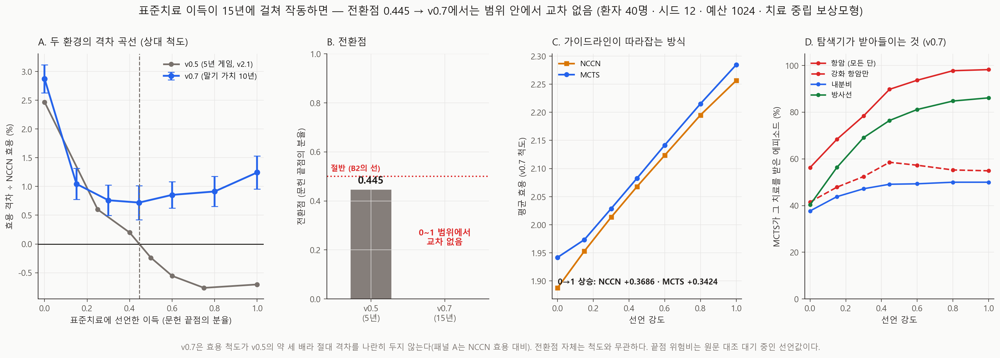
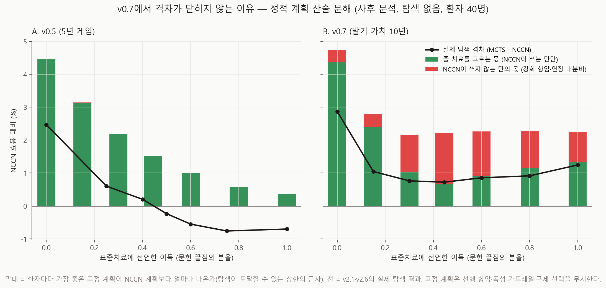

# 긴 게임에서는 44.5%가 버티지 않는다 — v2.6

- 실행일: 2026-10-22 사전등록·시작, 2026-10-25 완료 (중단 후 팔 단위 체크포인트로 이어 돌림)
- 입력: `data/processed/patients_with_nccn.csv` + `configs/dynamic_v0_7.json`(표준치료 사다리만 배율 조정)
- 핵심 코드: `analysis/58_run_tipping_v07.py`(사전등록, 커밋 `65cc63e`·`6e46233`),
  `analysis/59_visualize_tipping_v07.py`, `analysis/60_static_decomposition_v07.py`(**사후**),
  `analysis/dynamic/benefit.py`(`crossing_strength`·`relative_gap`)
- 용도: 핵심 주장 B2(표준치료 이득을 문헌값의 44.5%만 선언해도 결론이 뒤집힌다)가 **5년
  게임의 산물인지** 확인하는 강건성 실험. 새 질문을 여는 실험이 아니다(2026-10-22 사용자 승인).
- 금지된 해석: 실제 임상효과, 치료 권고, **"v0.7에서는 MCTS가 가이드라인을 이긴다"**

## 한 줄 결론

**버티지 않는다.** 말기 가치 환경(v0.7)에서는 표준치료 이득을 0에서 문헌 끝점까지 올려도
MCTS−NCCN 격차가 **한 번도 0을 넘지 않는다.** 가장 낮은 곳이 강도 0.445에서 **+0.0149**
(SE 0.0061, z +2.43, NCCN 대비 **+0.72%**)이고, 그 뒤로 **다시 올라** 강도 1에서 +0.0281
(+1.24%)이다.

그러나 이것은 "긴 게임에서는 MCTS가 이긴다"가 아니다. 사후 산술 분해(fig54)가 남은 격차의
상당 부분을 **NCCN이 한 번도 쓰지 않는 두 단** — 강화 항암과 연장 내분비 — 에 돌린다. 그
두 단의 추가 이득은 **선언값**이고(사다리 증분 고정, v2.1 한계 3), 말기 가치는 그 이득을
10년 더 쳐주지만 장기 독성은 셈하지 않는다. 즉 **v0.5의 헤드라인이 "표준치료는 소용없다"는
선언에 매달려 있었다면, v0.7의 격차는 "강화는 장기 비용 없이 5~10%를 더 준다"는 선언에
매달려 있다.** 매달린 선언이 바뀌었을 뿐, **격차가 가이드라인에 대한 진술이 아니라는 결론은
두 환경에서 같다.**

44.5%라는 숫자는 **v0.5에서만** 인용할 수 있다.

## 체스로 말하면

같은 대국을 5수가 아니라 15수까지 채점했다. 5수 채점에서는 "정석(NCCN)에 점수를 조금만
줘도 엔진이 진다"였다. 15수 채점에서는 엔진이 지지 않는다 — 그런데 엔진이 버티는 수를 보니
**정석 책에 아예 없는 수**(강화 항암·연장 내분비)이고, 그 수의 점수는 **우리가 매긴 것**이다.
엔진이 정석을 이긴 것이 아니라, 정석이 둘 수 없게 막아 둔 칸에 우리가 점수를 놓아 둔 것이다
— v1.5가 처음 잡은 그 비대칭이다.

## 추정 대상 (estimand)

> v2.1과 같은 40명(아형 균등, 코호트 A+B)·같은 12시드·같은 예산 1024·치료 중립 보상모형에서,
> **v0.7 환경**(구제 결정 + 말기 가치 10년)의 표준 항암·표준 내분비·국소 방사선의 선언된
> 위험비를 무작위 배정 끝점의 분율 `강도`만큼 올렸을 때의 MCTS−NCCN 효용 격차, 그리고
> 그것이 0을 지나는 강도(전환점). 사다리 증분은 v2.1처럼 유지한다.

v0.7의 효용 척도는 v0.5의 약 세 배이므로(v1.9) 두 환경의 격차는 **NCCN 효용 대비 상대값**으로
나란히 둔다. 전환점은 척도와 무관하다.

## 설계

| 항목 | 값 |
|---|---|
| 환경 | `configs/dynamic_v0_7.json` (SHA-256 `93d797e0…`) |
| 다이얼 | `with_standard_benefit(raw, 강도)` — v2.1과 같은 함수, 기하 보간, 증분 유지 |
| 강도 | 0 · 0.15 · 0.30 · **0.445** · 0.60 · 0.80 · 1.00 (v2.1의 전환점을 팔로 직접 둠) |
| 환자·시드·예산 | 40명 · 12시드 · 1024 (민감도 최소 설계) |
| 시드 유도 | v1.9와 동일(`BASE_SEED` + 1000·시드 + 환자 해시) → 강도 0 = v1.9의 v0.7 팔 |
| 실행 시간 | 3,251초(팔당 약 7.7분) |

다이얼이 v0.7에서도 중립인지는 실행 전에 테스트로 고정했다
(`tests/test_benefit.py::TerminalValueConfigTests` — 강도 0이 v0.7과 비트 단위로 같고, 구제
블록·말기 꼬리·재발 후 사망 배율은 어떤 강도에서도 건드리지 않으며, 증분이 유지된다).

### 사전 선언한 예측 (2026-10-22, 실행 전 커밋 `65cc63e`)

| # | 예측 | 결과 |
|---|---|---|
| 1 | **영대조** — 강도 0이 v1.9의 v0.7 팔(gap_decide)을 1e-9 안에서 재현 | **통과** (차이 0.0) |
| 2 | **주 예측: B2가 버틴다** — v0.7 전환점 < 0.50 | **빗나감** (0~1 범위에서 교차 없음) |
| 3 | **방향** — v0.7 전환점 < 0.445 (강도 0.445의 격차가 음수) | **빗나감** (+0.0149, z +2.43 — 반대 방향으로 구분됨) |
| 4 | **가이드라인이 더 많이 오른다** — 0→1에서 NCCN 상승 > MCTS 상승 | **통과** (+0.3686 대 +0.3424) |
| 5 | **잡음 안에서 단조** — 인접 쌍이 짝지은 SE의 2배 넘게 오르지 않음 | **통과** (최대 상승 z +1.14) |

예측 3의 방향은 v2.1 리포트 한계 6(2026-09-26)에 "말기 가치에서는 전환점이 더 낮아질 것으로
보인다"고 처음 적었다. **추론이 틀렸다.** 표준치료의 이득이 15년에 걸쳐 작동하면 가이드라인이
더 빨리 따라잡을 것이라고 봤지만, 같은 연장이 **가이드라인이 못 쓰는 단의 이득도** 15년에
걸쳐 쳐주었다.

예측 5는 **형식상 통과**지만 그 뜻을 정확히 적는다: 인접 쌍 하나하나는 잡음 안이지만,
강도 0.445 → 1.00 전체로는 격차가 **+0.0132 올랐고 짝지은 z = +2.45**(12시드 중 10 양수)다.
곡선은 단조 감소가 아니라 **U자**다.

## 결과

### 1. 격차 곡선 (fig53)



| 강도 | 격차 | SE | NCCN 대비 | MCTS | NCCN | MCTS 항암 수용 (강화) |
|---:|---:|---:|---:|---:|---:|---:|
| 0.000 | **+0.05420** | 0.00461 | +2.87% | 1.9420 | 1.8878 | 56% (42%) |
| 0.150 | +0.02040 | 0.00528 | +1.04% | 1.9734 | 1.9530 | 68% (48%) |
| 0.300 | +0.01531 | 0.00528 | +0.76% | 2.0287 | 2.0134 | 78% (52%) |
| **0.445** | **+0.01489** | 0.00613 | **+0.72%** | 2.0828 | 2.0679 | 90% (59%) |
| 0.600 | +0.01813 | 0.00487 | +0.85% | 2.1416 | 2.1235 | 94% (57%) |
| 0.800 | +0.02004 | 0.00575 | +0.91% | 2.2152 | 2.1951 | 98% (55%) |
| 1.000 | **+0.02807** | 0.00645 | **+1.24%** | 2.2844 | 2.2564 | 98% (55%) |

- **강도 0.445에서 격차 +0.0149, z +2.43, MDE 0.0172.** 0과 구분되지만 MDE보다 작다 —
  "양수로 구분된다"까지만 말하고 크기는 말하지 않는다. 12시드 중 8개만 양수다.
- **강도 1에서 +0.0281, z +4.35**, 12시드 중 11 양수.
- v0.5(v2.1)와 상대 척도로 나란히 두면, 강도 0에서는 비슷하게 시작한다(v0.5 +2.47%,
  v0.7 +2.87%). 갈라지는 것은 **강도 0.3 이후**다 — v0.5는 계속 내려가 0을 지나고, v0.7은
  +0.7% 근처에서 멈췄다가 다시 오른다.

### 2. 가이드라인은 여전히 따라잡는다 — 다만 끝까지는 아니다

0→1에서 NCCN이 **+0.3686**, MCTS가 **+0.3424** 오른다(예측 4 통과). v2.1의 기전("MCTS가
나빠져서가 아니라 가이드라인이 벌점을 그만 받아서")은 v0.7에서도 작동한다. 강도 0→0.15
구간에서 격차가 **−0.0338(z −4.49)** 줄어드는 것이 그것이다. 그런데 0.3 이후로는 두 정책이
**거의 평행하게** 오른다 — 따라잡기가 멈춘다.

### 3. 왜 멈추는가 — 사후 산술 분해 (fig54)



**사후 분석이다.** 실행 결과를 보고 쓴 `analysis/60_static_decomposition_v07.py`가, 탐색 없이
환자마다 세 고정 계획(수술 먼저)의 기대 효용을 계산한다(`plan_expected_utility`, v2.1의 미리보기).

- **guideline** — 단순화 NCCN 계획
- **restricted** — NCCN이 한 번이라도 쓰는 단만으로 만든 최선 계획 (항암 none/standard,
  내분비 none/standard, 방사선 전부)
- **full** — 모든 합법 단으로 만든 최선 계획 (강화 항암·연장 내분비 추가)

`restricted − guideline` = **어떤 치료를 줄지 고르는 몫**, `full − restricted` = **NCCN이 쓰지
않는 단의 몫**(v1.5의 비대칭).

| 환경 | 강도 | 고르는 몫 | NCCN이 안 쓰는 단의 몫 | 정적 상한 | 최선 계획의 강화 항암 |
|---|---:|---:|---:|---:|---:|
| v0.5 | 0.000 | +4.46% | 0.00% | +4.46% | 0% |
| v0.5 | 0.445 | +1.51% | 0.00% | +1.51% | 0% |
| v0.5 | 1.000 | +0.36% | 0.00% | +0.36% | 0% |
| v0.7 | 0.000 | +4.36% | +0.38% | +4.74% | 3% |
| v0.7 | 0.300 | +1.02% | **+1.13%** | +2.16% | **100%** |
| v0.7 | **0.445** | +0.67% | **+1.55%** | +2.22% | **100%** |
| v0.7 | 1.000 | +1.33% | **+0.93%** | +2.25% | **100%** |

(모두 NCCN 효용 대비. 연장 내분비는 v0.7에서 모든 강도에서 HR 양성 전원 = 50%.)

읽는 법:

1. **v0.5에서는 정적 상한이 0으로 수렴한다**(+4.46% → +0.36%). 표준치료에 이득이 붙을수록
   NCCN 계획이 최선 계획에 가까워지고, 그 좁은 여지를 탐색 손실이 넘어서는 곳이 v2.1의
   전환점이다. 강화 단은 v0.5에서 한 번도 최선이 아니다.
2. **v0.7에서는 정적 상한이 +2.2% 아래로 내려가지 않는다.** 강도 0.3부터 최선 고정 계획은
   **40명 전원에게 강화 항암**을 주고, 그 몫이 상한의 절반 이상(0.445에서 70%)이다.
3. **고르는 몫도 강도 0.445 이후 다시 커진다**(+0.67% → +1.33%). 그 내용을 세면(강도 1에서)
   NCCN이 방사선을 주지 않는 유방절제 환자 8명에게 **영역 방사선을 더하는 것**과 NCCN이
   항암을 주지 않는 3명에게 **표준 항암을 더하는 것**이다. 즉 v0.7에서 남은 격차는 거절이
   아니라 **가이드라인보다 더 많이 치료하는 쪽**에서 나온다 — v0.5와 **방향이 반대**다.
4. 실제 탐색 격차(선)는 v0.7에서 정적 상한의 약 1/3~1/2에 머문다. 탐색이 상한에 못 미치는
   것은 v2.1과 같다. 다른 것은 **상한 자체가 닫히지 않는다**는 점이다.

### 4. 탐색기는 무엇을 했나

MCTS는 강도와 함께 표준치료를 받아들인다(항암 56% → 98%, 방사선 40% → 86%, 내분비 38% →
50% = 자격 있는 전원). 강화 항암은 **42% → 59%(0.445) → 55%**로, 강도 0에서도 이미 v1.9가
보고한 수준(말기 가치가 강화 단을 키운다)이다. 정적 최선이 100% 강화를 주는 데 비해 탐색은
55~59%에서 멈춘다 — 독성 가드레일·선행 항암 경로·예산 1024의 해상도가 겹친 결과로 보이며,
분리하지 않았다.

## 무엇이 바뀌나

1. **B2의 숫자 44.5%는 v0.5 전용이다.** 헤드라인 인용 규칙의 조건("표준치료 이득이 문헌값의
   44.5% 미만일 때만")은 **v0.5 환경의 조건**으로 한정해 적는다. v0.7에서는 0~1 범위에서
   전환점이 없다.
2. **B2의 형태 — "격차는 선언에 매달려 있다" — 는 오히려 넓어진다.** v0.5에서는 "표준치료의
   이득 0"이라는 선언에, v0.7에서는 "NCCN이 쓰지 않는 강화 단의 추가 이득(위험비 0.95/0.90 등)과
   장기 독성 0"이라는 선언에 매달린다. 어느 환경에서도 **격차는 가이드라인에 대한 진술이
   아니다.** 연구 질문에 예/아니오로 답하지 않는다는 결론은 그대로다.
3. **v1.5의 비대칭이 다른 문으로 돌아왔다.** v1.5는 "NCCN이 한 번도 쓰지 않는 수준에만 이득이
   붙어 있으면 그 이득은 MCTS 전용"이라고 규약을 세웠다. v0.7에서는 말기 가치가 그 수준의 값을
   키워 격차의 대부분을 차지하게 했다. 규약은 맞았고, **새 환경에서 다시 검사하지 않은 것이
   빠진 고리**였다.
4. **"헤드라인은 강건한가?"에 대한 정직한 답**: 5년 게임에서는 표준치료 이득 선언 하나에
   44.5%에서 뒤집히고, 15년 게임에서는 뒤집히지 않는 대신 **가이드라인이 접근할 수 없는 단의
   선언에** 기댄다. 어느 쪽도 "MCTS가 더 낫다"를 지지하지 않는다.

## 기각한 가설

- **"말기 가치가 표준치료의 이득을 키우므로 전환점이 낮아진다"**(v2.1 한계 6, 예측 3) —
  **기각.** 표준치료의 이득만이 아니라 강화 단의 증분도 함께 키웠다.
- **"강도 0이 v1.9와 다르게 나오면 다이얼이 v0.7을 건드린 것"** — 영대조가 차이 0.0으로
  통과해 배제됐다. 결과의 차이는 다이얼 구현이 아니라 환경의 성질이다.

## 한계 (심각도 순)

1. **분해는 사후이고 정적이다.** fig54는 결과를 본 뒤 썼고, 고정 계획은 선행 항암·독성 가드레일·
   구제 선택을 무시한다. "남은 격차가 강화 단에서 온다"는 **산술 근거가 있는 해석**이지 탐색으로
   분리한 측정이 아니다. 직접 분리하려면 MCTS를 NCCN이 쓰는 단으로 제한한 팔이 필요하다(약 1시간,
   돌리지 않음 — 12월 마감 일정표상 새 실행은 여기서 멈춘다).
2. **사다리 증분 고정(v2.1 한계 3)이 이 결과의 핵심 가정이 됐다.** 표준치료가 좋아질 때 강화의
   *추가* 이득은 줄어드는 것이 임상적으로 더 그럴듯하다. 증분을 함께 줄이면 v0.7에서도 교차가
   생길 수 있다 — 돌리지 않았고 방향만 적는다.
3. **장기 독성이 모형에 없다.** 말기 가치는 재발 감소를 10년 더 쳐주지만 강화 항암의 장기 비용
   (심장독성·이차 혈액암 등)은 치료 시점의 급성 비용으로만 들어간다. **이득은 길고 비용은 짧은
   지평 비대칭**이며, v0.7 결과가 강화 쪽으로 기우는 것과 같은 방향이다. 수치로 재지 않았다.
4. **끝점 위험비는 원문 대조 대기 중인 선언값이다**(EBCTCG). 끝점이 바뀌면 곡선 전체가 다시
   계산된다.
5. **강도 0.445의 격차는 MDE(0.0172)보다 작다.** "양수로 구분된다"까지만 말한다.
6. **40명 · 12시드.** 순위가 아니라 곡선의 모양을 보고하며, v2.1과 같은 환자·시드를 써서 두
   환경 비교는 짝지어져 있다.

## 재현

```bash
py -m unittest tests.test_benefit -v
py analysis/58_run_tipping_v07.py          # 약 55분, 팔마다 data/processed/tipping_v07_v2_6_arms/에 저장
py analysis/60_static_decomposition_v07.py # 사후 산술 분해, 수 분
py analysis/59_visualize_tipping_v07.py    # fig53·fig54
```

입력 SHA-256·시드·커밋은 `run_manifest.json`(`git_commit_before_run` 6e46233).

## 산출물

| 파일 | 내용 |
|---|---|
| `metrics.json` | 사전 예측·설계·팔별 결과·판정 |
| `run_manifest.json` | 입력 해시·시드·커밋·실행 시간 |
| `tables/arms.csv`·`per_seed.csv` | 팔별·시드별 격차 |
| `tables/action_mix.csv` | 정책별 행동 구성 |
| `tables/compare_v05_v07.csv` | v2.1과 상대 척도 비교 |
| `tables/static_decomposition.csv` | 사후 산술 분해(집계만) |
| `figures/fig53_tipping_v07.png` | 곡선·전환점·효용·수용률 |
| `figures/fig54_static_decomposition_v07.png` | 정적 상한 분해 |

## 참고문헌

- Early Breast Cancer Trialists' Collaborative Group (EBCTCG) 메타분석 — 끝점 위험비의 출처(원문 대조 대기).
- Kocsis L, Szepesvári C. Bandit based Monte-Carlo planning. *ECML* 2006 (UCT).
